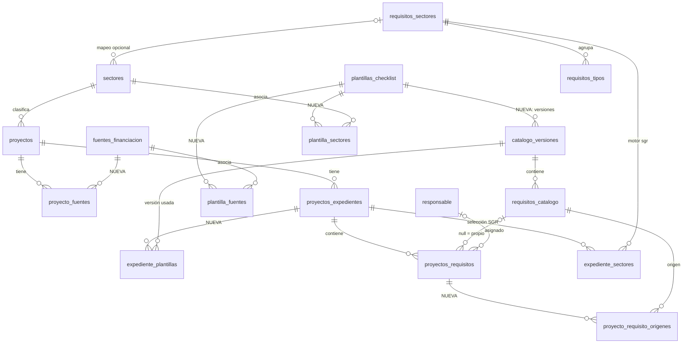
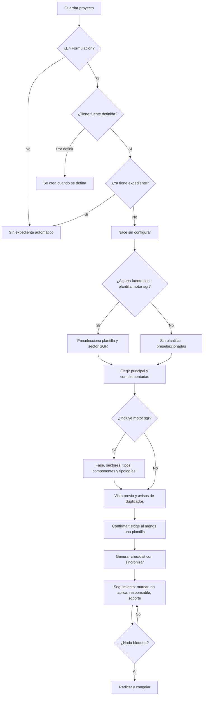

# Fuentes de financiación y plantillas de checklist: diseño

**Fecha:** 2026-11-06
**Origen:** "Propuesta de evolución del módulo de seguimiento de proyectos", entregada por el usuario.
**Estado:** diseño aprobado por secciones; pendiente de revisión del documento completo.

## Objetivo

Convertir el checklist de viabilización SGR en un sistema de plantillas configurables, para hacer seguimiento a proyectos de cualquier fuente de financiación sin crear un segundo motor y sin alterar los expedientes SGR existentes.

**Criterio de aceptación principal:** un administrador crea una plantilla, la asocia a varias fuentes y sectores, configura sus requisitos y la publica sin intervención de un desarrollador. Después, un usuario selecciona fuente, sector y plantillas de un proyecto, y genera un checklist independiente que sigue desde el módulo existente.

## Decisiones aprobadas

| Tema | Decisión |
|---|---|
| Integración | Generalizar las tablas actuales (enfoque A). Sin tablas paralelas ni copia de datos. |
| Responsable de cumplimiento | La plantilla indica el cargo o área; cada expediente asigna una persona del catálogo `responsable`. Administradores y Gestores siguen siendo quienes marcan. |
| Flujo del requisito | Pendiente, Cumplido o No aplica con justificación. Solo el "no aplica" se aprueba, y solo en los requisitos marcados para eso. |
| Fuentes del proyecto | Una o varias del catálogo, sin montos, o "Por definir". |
| Requisito condicionado | En plantillas nuevas, la condición es un texto y una persona decide si aplica. La plantilla SGR conserva sus reglas automáticas. |
| Duplicados | Código común definido por el administrador; una sola fila con varios orígenes. Los textos parecidos solo generan un aviso. |
| Creación del expediente | Automática para todo proyecto en Formulación con al menos una fuente definida. |
| Nombre en pantalla | "Expediente", sin "SGR" ni "de viabilización", junto a las plantillas que lleva. El cambio se hace en la etapa 5. |

**Fuera de alcance:** montos por fuente, preguntas configurables para automatizar condicionados, revisión de cada requisito cumplido, varios soportes vigentes por requisito, y definir qué requisitos aplican a cada financiador. Esto último lo aporta la entidad responsable; por eso solo se siembra la plantilla SGR.

---

## 1. Diagnóstico de la arquitectura actual

**Componentes**

| Capa | Elementos |
|---|---|
| Catálogo | `catalogo_versiones`, `requisitos_catalogo`, `requisitos_sectores`, `requisitos_tipos`, `requisitos_componentes`, `requisitos_tipologias` |
| Instancia | `proyectos_expedientes`, `proyectos_requisitos`, `expediente_sectores`, `expediente_tipos`, `expediente_componentes`, `expediente_tipologias` |
| Backend | `app/Services/Viabilizacion/` (`ExpedienteService`, `CatalogoService`, `EvaluadorRequisitos`, `ConfiguracionExpediente`), `ExpedienteController`, `CatalogoRequisitosController`, `routes/viabilizacion.php` |
| Frontend | `ExpedienteViabilizacion.jsx`, `ExpedienteConfiguracion.jsx`, `ExpedienteChecklist.jsx`, `ExpedientesSgrPanel.jsx`, `utils/expedienteChecklist.js`, `utils/expedientesResumen.js` |
| Pruebas | `tests/Feature/Viabilizacion/`, `tests/Unit/Viabilizacion/`, `tests/Feature/Schema/CatalogoRequisitosTest.php`, `tests/Fixtures/paridad_evaluador_sgr.json` y pruebas Vitest de `utils/` |

**Cómo se generan hoy los requisitos.** `ExpedienteService::sincronizar` lee las filas de la versión del expediente, `EvaluadorRequisitos` decide cuáles aplican y se crea una fila en `proyectos_requisitos` por cada una. Si un requisito deja de aplicar en un borrador, se marca `aplica = false` y conserva su cumplimiento. El texto se lee de la fila del catálogo, que no cambia una vez publicada.

**Qué se reutiliza:** versionado con publicación inmutable, instancia por expediente, `sincronizar`, evaluador, soportes privados, radicación que congela el expediente, expediente sin configurar y la pantalla del checklist.

**Qué pide conservar la propuesta y no existe.** Cada requisito solo guarda cumplido sí/no, usuario y fecha, una observación y un soporte. Estos elementos son **construcción nueva**:

- Estados de seguimiento distintos de cumplido sí/no.
- Responsables. `usuario_cumplido_id` es solo quien marcó la casilla.
- Historial. Desmarcar borra usuario y fecha, y reemplazar un soporte borra el archivo anterior.
- Categorías técnico, jurídico, etc. El SGR se organiza por secciones A, B, C y D.

**Limitaciones que condicionan el diseño**

- `proyectos.fuente_financiacion` es texto libre. 30 de los 31 proyectos de `gest_pro` dicen "Recursos propios y regalías", y el expediente automático busca las palabras `regalia` o `sgr`.
- Solo puede haber una versión vigente en todo el sistema, y cada expediente apunta a una sola versión.
- `seccion`, `fuente` y `codigo` son obligatorios y propios del SGR.
- Los 207 requisitos SGR dependen de fase, componentes, tipología y sector SGR.
- Hay dos catálogos de sectores: `sectores` (5 filas) y `requisitos_sectores` (14). Agua Potable y Vivienda apuntan al mismo sector SGR.
- `sectores` tiene rutas de administración, pero apuntan a métodos que no existen en `ProyectoController` y ninguna pantalla las usa.
- `SECCIONES` y `agruparRequisitos` en `expedienteChecklist.js` suponen las secciones A, B, C y D.
- La radicación exige el 100 % de todas las filas que aplican.

**Datos en `gest_pro` (2026-11-06):** 31 proyectos, 10 expedientes (9 borradores, 7 de ellos sin configurar, y 1 radicado), 290 filas de checklist, 19 cumplidas, 0 observaciones y 0 soportes. Una sola versión del catálogo, con 207 requisitos. El módulo no está en `main`.

---

## 2. Propuesta funcional

### Selección de plantillas

Se ofrecen las plantillas activas con versión publicada que cumplan ambas condiciones:

- `todas_fuentes` o asociación con alguna fuente del proyecto.
- `todos_sectores` o asociación con el sector del proyecto. Si el proyecto no tiene sector, solo las de todos los sectores, con un aviso.

Cada opción muestra nombre, descripción, fuentes, sectores, número de requisitos, versión y estado. Se elige una principal y las complementarias que hagan falta. Un expediente puede tener como máximo una plantilla con motor `sgr`.

Cambiar las fuentes o el sector de un proyecto no altera un expediente ya configurado; solo muestra un aviso si alguna plantilla dejó de ser compatible.

### Motores de plantilla

| Motor | Qué requisitos aplican | Configuración adicional |
|---|---|---|
| `sgr` | Los que decide `EvaluadorRequisitos`, sin cambios | Fase, sectores, tipos, componentes y tipologías SGR |
| `simple` | Todos los activos; los condicionados nacen `por_definir` | Ninguna |

### Estados del requisito en el expediente

El estado visible se calcula a partir de `cumplido` y `estado_aplicabilidad`.

| Estado | Condición | Cuenta en el avance | Bloquea radicar |
|---|---|---|---|
| Por definir | `por_definir` | Sí, como pendiente | Sí |
| Pendiente | `aplica`, no cumplido | Sí | Sí |
| Cumplido | `aplica`, cumplido | Sí | No |
| No aplica, por aprobar | `no_aplica_pendiente` | Sí, como pendiente | Sí |
| No aplica | `no_aplica` | No | No |

- **Requisitos opcionales:** se pueden marcar, pero no cuentan en el avance ni bloquean la radicación.
- **Condicionados:** al resolverse como "aplica" se comportan como obligatorios.
- **Avance:** cumplidos entre los que cuentan. Como todos los requisitos SGR quedan obligatorios y en `aplica`, sus cifras no cambian.
- **Radicar:** exige al menos un requisito que cuente y ninguno que bloquee.
- **Filas retiradas:** `aplica = false` conserva su significado actual (el sistema la retiró) y es independiente de `estado_aplicabilidad` (lo decidió una persona).

### "No aplica"

- Exige justificación.
- Si `requiere_aprobacion_no_aplica` está activo, queda por aprobar. Lo aprueba un Administrador o Gestor distinto de quien lo marcó.
- Excepción: un Administrador puede aprobar lo que él mismo marcó, y queda registrado. Hoy `gest_pro` tiene un solo usuario y, sin esta excepción, el flujo se bloquearía.
- Si se rechaza, vuelve a `aplica` y queda en el historial.
- `cargo_revision` indica en la plantilla quién debería revisar. No restringe quién aprueba.

### Duplicados

- Si varias plantillas traen el mismo `codigo_comun`, queda una fila con todos sus orígenes y el carácter más exigente (obligatorio, luego condicionado, luego opcional).
- Se considera solo lo que aplica: si el evaluador SGR descarta su fila, esa plantilla no aporta origen.
- Quitar una plantilla de un borrador retira sus orígenes. Una fila sin orígenes queda con `aplica = false` y conserva su trabajo.
- Los textos muy parecidos sin código común generan un aviso al configurar; nunca se fusionan solos.

### Requisitos propios del proyecto

Se agregan desde el checklist, con `requisito_catalogo_id = null` y sus textos en la fila. Tienen el mismo seguimiento y no modifican ninguna plantilla.

### Versiones

- Una versión publicada no se modifica. Para cambiarla se crea un borrador, se edita y se publica; cada plantilla tiene máximo un borrador y una versión vigente.
- Los expedientes nuevos usan la versión vigente; los existentes conservan la suya.
- **Aplicar una versión nueva** es una acción explícita, solo en borrador, con vista previa:
  - Los requisitos se reconocen por `clave`.
  - Los que siguen conservan cumplimiento, observación, soporte y responsable.
  - Los nuevos nacen pendientes.
  - Los retirados quedan con `aplica = false` y conservan su información.
- Un expediente radicado queda congelado. Para volver a radicar se crea otro, que copia la configuración y no el cumplimiento, como hoy.

### Duplicar una plantilla

Crea una plantilla independiente en borrador, con los requisitos que se elijan y el mismo `codigo_comun`. Al duplicar la plantilla SGR se puede convertir a motor `simple`:

- Las secciones y condiciones automáticas dejan de usarse.
- Los requisitos con condición distinta de `siempre` quedan como condicionados, con la condición original en `condicion_descripcion`, para que el administrador la redacte antes de publicar.

Ningún requisito se vuelve aplicable a otra fuente sin que un administrador lo publique, como exige la propuesta.

### Reglas de la propuesta

| # | Regla | Cómo se cumple |
|---|---|---|
| 1 | Proyecto con fuente o por definir | Validación del formulario: al menos una fuente o `financiacion_por_definir` |
| 2 | Varias fuentes por proyecto | `proyecto_fuentes` |
| 3 | Plantilla con varias fuentes y sectores | `plantilla_fuentes`, `plantilla_sectores` |
| 4 | Fuente con varias plantillas | Las mismas tablas de relación |
| 5 | Obligatorio, opcional o condicionado | `caracter` |
| 6 | "No aplica" con justificación | Validación en servicio y API |
| 7 | Sin cambios retroactivos | Versiones inmutables y actualización explícita |
| 8 | Sin requisitos duplicados | `codigo_comun` y `proyecto_requisito_origenes` |
| 9 | Eliminación restringida | Con expedientes, solo se desactiva; las claves foráneas lo impiden en base de datos |
| 10 | Trazabilidad completa | `checklist_historial` y soportes conservados |

---

## 3. Diagrama entidad-relación

Las relaciones marcadas como **NUEVA** usan tablas que no existen hoy. El resto se conserva con los cambios de la sección 4.

`checklist_historial` no tiene claves foráneas a las entidades que registra (ver migración 9), por lo que no aparece en el diagrama. `expediente_tipos`, `expediente_componentes` y `expediente_tipologias` siguen el mismo patrón que `expediente_sectores`.

---

## 4. Migraciones

Una migración por paso, cada una con `down()` y ensayada de subida y bajada en base temporal. Nunca se ensayan en `gest_pro` ni se usa `migrate:rollback` allí.

| # | Etapa | Migración | Contenido | Rollback |
|---|---|---|---|---|
| 1 | 1 | `create_fuentes_financiacion_table` | `id`, `clave` (única y opcional; `sgr` para regalías), `nombre`, `descripcion`, `orden`, `activo`. Inserta las 10 fuentes de la propuesta. | Elimina la tabla |
| 2 | 1 | `create_proyecto_fuentes_table` | `proyecto_id`, `fuente_id`; PK compuesta; cascada desde proyecto, restricción desde fuente | Elimina la tabla |
| 3 | 1 | `add_financiacion_a_proyectos` | `financiacion_por_definir` (bool), `fuente_financiacion_original` (text). Convierte el texto actual (sección 7). | Restaura el texto original de los proyectos no editados, conserva lo editado y elimina las columnas |
| 4 | 2 | `create_plantillas_checklist_tables` | `plantillas_checklist` (`clave` única y opcional, `nombre`, `descripcion`, `alcance`, `todas_fuentes`, `todos_sectores`, `motor`, `activo`, `usuario_creo_id`, timestamps), `plantilla_fuentes`, `plantilla_sectores`. Siempre crea la plantilla SGR (`clave = 'sgr'`), asociada a la fuente SGR y a todos los sectores. | Elimina las tablas |
| 5 | 2 | `add_plantilla_a_catalogo_versiones` | `plantilla_id`, `usuario_publico_id`. Asigna la plantilla SGR a las versiones existentes. Cambia `unique(numero)` por `unique(plantilla_id, numero)`. | Falla con mensaje claro si hay versiones de otras plantillas; si no, restaura |
| 6 | 2 | `create_expediente_plantillas_table` | `expediente_id`, `catalogo_version_id`, `es_principal`. Registra la versión actual de cada expediente. | Elimina la tabla |
| 7 | 3 | `add_seguimiento_a_requisitos_catalogo` | `descripcion`, `categoria`, `tipo_requisito`, `caracter` (por defecto `obligatorio`), `cargo_cumplimiento`, `cargo_revision`, `soporte_requerido`, `referencia_normativa`, `condicion_descripcion`, `requiere_aprobacion_no_aplica`, `codigo_comun`. `seccion`, `fuente` y `codigo` pasan a opcionales. En SGR, `codigo_comun = clave`. | Falla con mensaje claro si hay filas sin sección, fuente o código; si no, restaura |
| 8 | 3 | `add_seguimiento_a_proyectos_requisitos` | `estado_aplicabilidad` (por defecto `aplica`), `justificacion_no_aplica`, `usuario_no_aplica_id`, `usuario_aprobo_id`, `fecha_aprobacion`, `caracter`, `responsable_id`. | Elimina las columnas |
| 9 | 3 | `create_checklist_historial_table` | `id`, `entidad_tipo`, `entidad_id`, `expediente_id`, `evento`, `antes` (JSON), `despues` (JSON), `usuario_id`, `created_at`. Sin claves foráneas a las entidades, para sobrevivir a su eliminación. | Elimina la tabla |
| 10 | 5 | `add_requisitos_propios` | `requisito_catalogo_id` y `proyectos_expedientes.catalogo_version_id` pasan a opcionales; agrega `titulo_propio`, `descripcion_propia`, `categoria_propia`. Crea `proyecto_requisito_origenes` y lo llena desde cada fila actual. | Falla con mensaje claro si hay requisitos propios o expedientes sin versión SGR; si no, restaura |
| 11 | 6 | `drop_catalogo_version_de_expedientes` | Retira `proyectos_expedientes.catalogo_version_id`, cuando ya todo lee de `expediente_plantillas`. Hasta entonces, solo se escribe en expedientes con motor `sgr`. | Restaura la columna desde la plantilla principal |

La plantilla SGR y las 10 fuentes se crean en migración, no en un seeder, para que existan en cualquier entorno y en las pruebas antes de sembrar el catálogo. `CatalogoRequisitosSgrSeeder` se ajusta para colgar su versión de esa plantilla.

---

## 5. Flujo de creación y configuración del expediente

Como hoy, un fallo en la creación automática se registra y no interrumpe el guardado del proyecto.

**Cambios en el servicio y la API**

- `financiadoConRegalias` se retira. `correspondeAutomatico` usa `proyecto_fuentes`: primero solo para la fuente `sgr` (etapa 1) y luego para todas (etapa 5), porque antes no hay plantillas para otras fuentes.
- `sincronizar` recorre las plantillas del expediente y aplica las reglas de cada motor.
- `progresoDe`, `resumenPorProyecto` y `radicar` usan una sola definición de "cuenta" y "bloquea".
- `CatalogoService` trabaja por plantilla; `/catalogo-requisitos/vigente` se conserva para el SGR.
- Las rutas de fuentes de financiación están en `routes/api.php`, junto a los demás catálogos. Rutas nuevas en `routes/viabilizacion.php`: plantillas y sus versiones (`gestionar-catalogos`); no aplica, aprobación, responsable, requisitos propios y aplicar versión (`editar-datos`); consulta y descarga desde historial (autenticado).
- Los soportes reemplazados se descargan por el id del historial. La ruta del archivo nunca se expone.

---

## 6. Interfaces

Con el armazón, los tokens `--gp-*` y los patrones del rediseño. Se registran en `utils/navegacion.js` para que aparezcan en el riel, la barra móvil y Ctrl+K.

**Administración (solo Administrador)**

| Pantalla | Contenido |
|---|---|
| Parámetros → Fuentes de financiación | Crear, editar y desactivar |
| Parámetros → Sectores | Crear, editar y desactivar. Se implementan `guardarSector` y `activarSector`, y se retira `eliminarSector` |
| Plantillas de checklist | Lista con búsqueda, versión, estado y número de requisitos; crear, duplicar y desactivar |
| Detalle: General y asociaciones | Nombre, descripción, alcance, fuentes y sectores, con "todas" como opción |
| Detalle: Requisitos | Constructor con todos los campos y orden. En motor `sgr` agrega sección, sector, tipo y condición, validada con `/catalogo-requisitos/validar-condicion` |
| Detalle: Vista previa | El checklist como lo verá el usuario |
| Detalle: Historial de versiones | Versiones, quién publicó y cuándo; publicar y crear borrador. Una versión publicada se muestra solo para lectura |

**Trabajo diario**

| Pantalla | Cambio |
|---|---|
| Formulario de proyecto (`Parametros.jsx`) | Selección múltiple de fuentes y casilla "Por definir", en lugar del texto libre |
| `ExpedienteConfiguracion.jsx` | Paso de plantillas, avisos de duplicados y panel SGR solo si corresponde |
| `ExpedienteChecklist.jsx` | Estado, responsable, "No aplica", aprobación, "Agregar requisito propio" e historial por requisito. Las filas SGR se agrupan por sección; las demás, por plantilla y categoría |
| `ExpedienteViabilizacion.jsx` | Plantillas aplicadas con su versión y acción "Aplicar versión nueva" con vista previa |
| `ExpedientesSgrPanel.jsx` | Filtros por fuente y responsable. Rutas sin cambios. Su título está en "Textos en pantalla" |

**Textos en pantalla**

Hasta la etapa 4 todos los expedientes son de regalías, así que los textos actuales siguen siendo correctos. La etapa 5 crea expedientes de otras fuentes, y por eso estos textos cambian en esa etapa:

| Archivo | Hoy | Pasa a |
|---|---|---|
| `utils/navegacion.js`, `Dashboard.jsx`, `ModoSala.jsx` | Expedientes SGR | Expedientes |
| `ExpedienteViabilizacion.jsx`, antetítulo | Viabilización de proyectos · Sistema General de Regalías | Seguimiento de proyectos |
| `ExpedienteViabilizacion.jsx`, título | Expediente de viabilización SGR #12 | Expediente #12, y al lado `Plantillas: SGR, Obras de agua`, o `Sin plantillas` si aún no tiene |
| `ExpedienteViabilizacion.jsx`, sin expediente | Este proyecto aún no tiene expediente de viabilización | Este proyecto aún no tiene expediente |
| `ExpedienteViabilizacion.jsx`, sin expediente | Crea uno para armar su checklist de requisitos del SGR. | Crea uno para armar su checklist de requisitos. |
| `ModalProyecto.jsx`, botón | Abrir expediente de viabilización SGR | Abrir expediente |
| `ModalProyecto.jsx`, dato | Requisitos SGR cumplidos | Requisitos cumplidos |
| `Parametros.jsx`, botón y su `title` | Expediente SGR / Expediente de viabilización SGR | Expediente |
| `utils/tablero.js`, etiqueta | Requisitos SGR | Requisitos |
| Descripción de `expedientes:crear-faltantes` en `routes/console.php` | Crea el expediente SGR… con la fuente SGR | Crea el expediente, sin configurar, a los proyectos en Formulación con al menos una fuente definida que no tienen |

Reglas para este cambio:

- **El nombre sale de las plantillas, no de las fuentes.** Las plantillas definen el checklist; un proyecto puede tener una fuente sin plantilla, como los 30 que tienen SGR y Recursos propios.
- **Lo propio de regalías conserva la sigla,** y solo se muestra si el expediente tiene una plantilla con motor `sgr`: "Fase SGR" en `utils/expedienteChecklist.js`, la instrucción "Revisa en el panel la fase SGR…" en `ExpedienteViabilizacion.jsx` y el panel SGR de la configuración.
- **La búsqueda sigue encontrando "SGR".** Al quitarlo del título de `utils/navegacion.js`, se agrega `sgr` a sus `palabras`.
- **Los nombres internos no cambian:** la ruta `/viabilizacion/:proyectoId`, `routes/viabilizacion.php`, `ExpedienteViabilizacion`, `ExpedientesSgrPanel`, `VISTA.EXPEDIENTES` y las tablas. Así los enlaces guardados siguen funcionando.
- **Pruebas:** se actualizan los textos que comprueban `navegacion.test.js` y `tablero.test.js`, y se agrega una prueba de que la búsqueda encuentra "SGR" y de que un expediente sin plantilla `sgr` no muestra "Fase SGR".

---

## 7. Estrategia de migración del checklist SGR

**Principio:** ningún dato se mueve. Los ids de versiones, requisitos, expedientes y filas no cambian.

1. Crear la plantilla SGR y asignarle la versión 1.
2. Registrar en `expediente_plantillas` la versión de los 10 expedientes, como principal.
3. Valores por defecto en los 207 requisitos: `caracter = obligatorio`, `codigo_comun = clave`, `categoria` vacía. La categoría no se inventa: la define la entidad responsable en una versión nueva.
4. Filas de los expedientes: `estado_aplicabilidad = aplica`, `caracter = obligatorio`, y un origen por fila.
5. Convertir el texto de la fuente:
   - Contiene `regalia` o la palabra completa `sgr` → SGR.
   - Contiene `recursos propios` → Recursos propios.
   - Ambos → las dos fuentes.
   - Vacío o sin reconocer → `financiacion_por_definir`, con un informe que muestra cada texto distinto y su resultado, para revisar también negaciones como "Sin regalías". Nada se asigna a "Otras" por adivinar.
   - El texto original queda en `fuente_financiacion_original`, y `fuente_financiacion` guarda los nombres unidos para las vistas que ya lo muestran.

**Verificación de que nada cambió.** En base temporal copiada de `gest_pro`, se guarda antes de migrar y se compara después, por cada expediente: filas que aplican con su requisito, cumplidos, porcentaje, estado y fecha de radicación. Cualquier diferencia detiene la etapa.

**Aplicación en `gest_pro`:** respaldo previo, `migrate` hacia adelante y la misma comparación. Solo se hace con autorización del usuario.

`expedientes:crear-faltantes` se generaliza a todas las fuentes en la etapa 5. Se revisa primero con `--simular` y solo se ejecuta con autorización, porque crea expedientes y aumenta los "sin configurar" del tablero.

---

## 8. Riesgos y medidas

| Riesgo | Efecto | Medida |
|---|---|---|
| Cambian los porcentajes o el checklist de un expediente SGR | Pérdida de confianza en el seguimiento | Comparación antes y después, pruebas actuales y paridad del evaluador en cada etapa |
| La conversión del texto de la fuente clasifica mal | Plantillas ofrecidas de forma incorrecta | Reglas conservadoras, "Por definir" ante la duda, original conservado e informe |
| Cambiar el `unique` de `numero` o `vigente` rompe supuestos | Dos versiones vigentes o seeder incorrecto | Búsqueda de vigente siempre por plantilla, y prueba de que publicar no afecta a otras plantillas |
| Pruebas actuales crean versiones sin plantilla | Fallos masivos ajenos a la funcionalidad | La plantilla SGR siempre existe por migración, y el modelo la asigna si no se indica otra |
| Reglas de avance dispersas | Cifras distintas en tablero, modal y expediente | Una sola definición en el servicio, y el frontend no la recalcula |
| Solo Administrador puede aprobar lo propio | Se reduce el control de doble revisión | Queda registrado en el historial; se puede restringir cuando haya más usuarios |
| Crece el almacenamiento por soportes conservados | Más disco | Aceptado; los archivos siguen siendo privados y se pueden limpiar con un proceso futuro |
| Más expedientes sin configurar tras generalizar la creación | Tablero con más pendientes | Ejecución con `--simular` y autorización explícita |
| Rollback imposible con datos nuevos | No se puede revertir sin perderlos | `down()` conserva lo ingresado o, si no puede, falla con mensaje claro en vez de borrar datos; respaldo antes de migrar |
| La rama base aún no está en `main` | Conflictos al integrar | Trabajar en `feature/plantillas-checklist` desde `feature/rediseno-interfaz`, e integrar primero `feature/expediente-viabilizacion` |
| Lotes de migración mezclados en `gest_pro` | `migrate:rollback` no es seguro | No usarlo en `gest_pro`; restaurar el respaldo si hace falta |

**Pendientes externos que este trabajo no resuelve:** la fase de los 153 requisitos de la sección C, que irá en una versión nueva de la plantilla SGR cuando se aporte; y los requisitos reales de cada financiador, que define la entidad responsable.

---

## Etapas de entrega

Cada etapa se valida con el usuario antes de seguir, y todas exigen que las pruebas del módulo y la paridad del evaluador sigan pasando. La única excepción deliberada son las pruebas de `ExpedienteAutomaticoTest` que detectan regalías por palabras en el texto y las que envían `fuenteFinanciamiento` como texto: en la etapa 1 se reescriben para usar el catálogo, sin cambiar lo que comprueban.

| # | Etapa | Migraciones | Se considera lista cuando |
|---|---|---|---|
| 1 | Fuentes y sectores | 1-3 | El proyecto usa el catálogo, los 31 quedan migrados con informe, las dos pantallas de administración funcionan y el expediente automático detecta SGR por la fuente `sgr`, no por palabras en el texto |
| 2 | Plantillas sobre versiones | 4-6 | El SGR es una plantilla, la comparación de los 10 expedientes no muestra diferencias y nada cambia en pantalla |
| 3 | Seguimiento del requisito | 7-9 | Estados, responsables, "no aplica" con aprobación e historial funcionan sobre expedientes SGR |
| 4 | Administración de plantillas | — | Un administrador crea, duplica, asocia, configura y publica una plantilla sin desarrollador |
| 5 | Composición en el expediente | 10 | Se eligen varias plantillas, se combinan duplicados, se agregan requisitos propios, el expediente automático cubre todas las fuentes, los textos en pantalla dicen "Expediente" y se cumple el criterio de aceptación principal |
| 6 | Versiones en expedientes y cierre | 11 | Actualización con vista previa, pantalla de historial, tablero generalizado y filtros |
