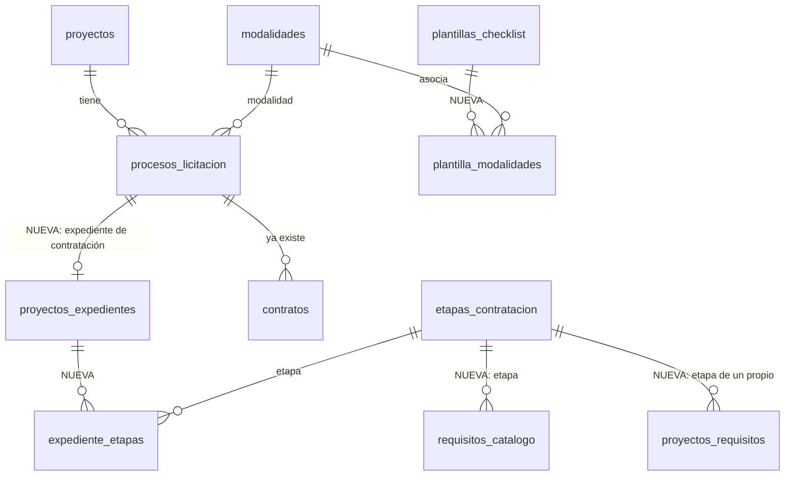

# Procesos de contratación con revisión por etapa: diseño

**Fecha:** 2026-11-17
**Origen:** pedido del usuario: "hoy no hay una revisión como tal de los proyectos en licitación". La guía de Colombia Compra para SECOP II sirve de punto de partida, y el seguimiento debe ser parametrizable para procesos que no van por SECOP.
**Estado:** aprobado por el usuario el 2026-11-17. Etapa 1 (catálogos y procesos) validada y aplicada en `gest_pro`. **Corrección del 2026-11-17:** el proceso y el contrato se unifican en un solo registro, el contrato (sección 10). Donde este documento hable de "proceso", la sección 10 manda.

## Objetivo

Que cada proceso de contratación de un proyecto (por ejemplo, la obra y su interventoría) tenga:
- un checklist de lo que se debe tener y publicar, agrupado por etapa;
- un cronograma con fecha programada y real de cada etapa;
- una revisión formal de cada etapa por parte de una persona.

Todo con el motor de expedientes y plantillas que ya existe, sin crear un segundo motor, y sirve igual para SECOP II, SECOP I, la Tienda Virtual o procesos sin plataforma.

**Criterio de aceptación principal:**
1. Un administrador publica una plantilla de contratación para una modalidad.
2. Un usuario registra un proceso de un proyecto y sigue su checklist por etapas.
3. La persona de revisión aprueba o devuelve cada etapa, y el tablero muestra en qué etapa va cada proceso y qué fechas están vencidas.

## Decisiones aprobadas

| Tema | Decisión |
|---|---|
| Revisión | Por etapa, no por ítem (decisión del usuario, 2026-11-17). |
| Efecto de la revisión | Solo avisa: nunca bloquea marcar ítems ni avanzar (decisión del usuario, 2026-11-17). |
| Motor | Se reutilizan expedientes, plantillas, versiones, "no aplica", requisitos propios e historial. Un expediente de contratación es un expediente con `tipo = contratacion`. |
| Contenido de la plantilla | Se siembra un **borrador** "Licitación pública – SECOP II" a partir de la guía de Colombia Compra. No se publica hasta que la entidad lo valide (jurídica o contratación), igual que los requisitos de cada financiador. |
| Plazos legales | No se inventan. La guía casi no los da; la plantilla puede llevar plazos orientativos que defina la entidad. |

**Fuera de alcance:**
- Integración con SECOP (consultar el estado de un proceso en los datos abiertos). Queda para después, si se decide.
- Días hábiles con calendario de festivos y plazos mínimos automáticos. Es la etapa 6 opcional.
- Revisión de cada ítem.
- Bloquear el avance por revisión.

---

## 1. Fuente: guía de Colombia Compra

"Guía sobre el uso del SECOP II – Modalidades de contratación: Licitación pública", CCE-SEC-G1-18, versión 1 del 20/04/2022, 76 páginas. Se obtuvo de https://www.colombiacompra.gov.co/base-conocimiento/licitacion-publica-secop-ii.

Es una guía de **uso de la plataforma**: explica cómo hacer cada paso en SECOP II, no qué exige la ley en cada etapa.

- **Sus capítulos:**
  - creación del proceso;
  - pliego borrador (información general, configuración y cronograma, configuración financiera con CDP y BPIN, cuestionario, lista de precios, evaluación, garantías);
  - publicación del borrador;
  - área de trabajo;
  - respuesta a observaciones;
  - pliego definitivo y su publicación;
  - adendas;
  - apertura y verificación de ofertas;
  - informe de evaluación y subsanaciones;
  - respuesta a observaciones al informe;
  - declaratoria de desierto;
  - selección y adjudicación (carta de aceptación y contrato electrónico).
- **Reglas concretas que menciona:**
  - el aviso de convocatoria y los estudios previos se publican con la misma fecha;
  - las adendas, no menos de 3 días hábiles antes del cierre, y entre 7:00 a. m. y 7:00 p. m.;
  - el cronograma incluye las audiencias de riesgos y de adjudicación, aunque se hagan fuera de la plataforma;
  - si la compra es de alimentos, el porcentaje mínimo del 30 % a pequeños productores (Decreto 248 de 2021).
- **Normas que cita:** el Decreto 1082 de 2015 y el Decreto 248 de 2021.

Los términos legales de cada modalidad (Ley 80 de 1993, Ley 1150 de 2007 y Decreto 1082 de 2015) los debe aportar la entidad.

## 2. Diagnóstico

- **`procesos_licitacion`:** tiene `proyecto`, `codigo_proceso`, `tipo_proceso`, `modalidad`, `entidad_contratante`, `tipo_proponente`, `entidad_proponente` y `monto`, sin timestamps. Está vacía y ninguna pantalla ni controlador la usa.
- **`eventos_licitacion`:** tiene `proyecto`, `proceso`, `descripcion`, `fecha` y `cumplido`. Está vacía y sin uso.
- **`modalidades` y `tipos_procesos`:** son catálogos de `nombre` y `activo`, vacíos. Tienen rutas en `routes/api.php`, pero apuntan a métodos que no existen en `ProyectoController`.
- **`contratos`:** ya tiene la clave foránea `proceso_licitacion` (`nullOnDelete`).
- **Fase del proyecto:** "Licitación" es solo una etiqueta.
- **El motor de expedientes** se pensó para la viabilización. `Proyecto::expedientes()`, el resumen del tablero, la creación automática y `expedientes:crear-faltantes` suponen que todo expediente es de viabilización. Al generalizar, hay que cuidar esos puntos (sección 8).

## 3. Propuesta funcional

### Proceso de contratación

Un proyecto puede tener varios procesos, por ejemplo la obra y la interventoría. Cada proceso registra:
- objeto;
- modalidad: licitación pública, selección abreviada, concurso de méritos, contratación directa, mínima cuantía o régimen especial;
- plataforma: SECOP II, SECOP I, Tienda Virtual o ninguna;
- número del proceso y enlace (opcionales);
- entidad contratante y valor;
- estado.

**Estados:** en preparación, publicado, en evaluación, adjudicado, desierto, celebrado o cancelado. Los cambia una persona y quedan en el historial. No se calculan solos, porque el checklist solo avisa.

### Expediente de contratación

- Al crear el proceso se crea su expediente (`tipo = contratacion`), con la plantilla compatible preseleccionada.
- Una plantilla es compatible si es de uso contratación, está activa, tiene versión vigente y está asociada a la modalidad del proceso (o a todas).
- Además, como hoy, la plantilla debe coincidir con las fuentes y el sector del proyecto (o servir para todos).
- Lo demás funciona como en viabilización:
  - una plantilla principal y complementarias;
  - duplicados unidos por código común;
  - requisitos propios, que eligen su etapa;
  - "no aplica" con aprobación;
  - responsables de cumplimiento y revisión;
  - soportes, historial, Excel e impresión;
  - aplicar una versión nueva con vista previa.
- **Cerrar** reemplaza a "Radicar". Se puede cerrar con pendientes o con etapas sin aprobar, pero se pide confirmación, el aviso dice cuántos quedan y queda en el historial. Un expediente cerrado queda congelado, como un radicado.

### Etapas

- **Catálogo administrable** `etapas_contratacion` (Parámetros → Etapas de contratación): clave, nombre, descripción, orden y activo. Se siembra con las etapas de la guía, más la planeación al inicio y el contrato al final:

| Orden | Clave | Etapa | Base en la guía |
|---|---|---|---|
| 1 | `planeacion` | Planeación y estudios previos | Configuración financiera (CDP, BPIN, Plan Anual de Adquisiciones) y estudios previos |
| 2 | `pliego_borrador` | Creación del proceso y pliego borrador | Capítulos 2 y 3 |
| 3 | `publicacion_borrador` | Publicación del proyecto de pliego y aviso de convocatoria | Capítulo 4 |
| 4 | `observaciones_borrador` | Observaciones al proyecto de pliego | Capítulo 6 |
| 5 | `pliego_definitivo` | Apertura y pliego definitivo | Capítulos 7 y 8 |
| 6 | `adendas` | Adendas | Capítulo 9 |
| 7 | `cierre` | Cierre y apertura de ofertas | Capítulo 10 |
| 8 | `evaluacion` | Evaluación y subsanaciones | Capítulo 11 |
| 9 | `observaciones_informe` | Observaciones al informe de evaluación | Capítulo 12 |
| 10 | `adjudicacion` | Adjudicación o declaratoria de desierto | Capítulos 13 y 14 |
| 11 | `contrato` | Contrato y garantías | Contrato electrónico (capítulo 14) |

- Cada requisito de una plantilla de contratación pertenece a una etapa. Las etapas de un expediente son las que tienen al menos una fila, ordenadas según el catálogo.
- El checklist se agrupa por etapa; dentro de cada etapa, por plantilla y categoría, como hoy.

### Revisión por etapa (solo avisa)

**Estados de una etapa:**

| Estado | Cuándo |
|---|---|
| Pendiente | Tiene ítems que cuentan sin cumplir |
| Lista para revisar | Todo lo que cuenta está cumplido o con "no aplica" aprobado |
| Aprobada | Una persona la aprobó |
| Devuelta | Una persona la devolvió con observación; vuelve a "Pendiente" o a "Lista para revisar" cuando alguien marca algo después |
| Aprobada, con cambios | Algo de la etapa cambió después de aprobarla. Es un aviso: la aprobación no se pierde |

- **Aprobar** lo hace un Administrador o Gestor.
  - Con ítems pendientes también se puede: se pide confirmación, se dice cuántos quedan y el historial lo registra (`con_pendientes`).
  - El cargo o la persona de revisión de la plantilla indica quién debería revisar; no restringe, igual que en el "no aplica".
- **Devolver** exige observación.
- **Marcar ítems de una etapa posterior** a una sin aprobar se puede. La pantalla avisa: "La etapa anterior aún no está aprobada".
- Las observaciones, aprobaciones y devoluciones quedan en el historial del expediente y de la etapa.

### Cronograma

- Cada etapa del expediente tiene **fecha programada**, que llena una persona, y **fecha real**, que por defecto es la de aprobación y se puede corregir.
- Avisos en días calendario: "vencida" si la fecha programada pasó sin aprobación, y "próxima" si faltan 3 días o menos.
- La plantilla puede traer un texto de plazo orientativo por etapa, por ejemplo "Adendas: a más tardar 3 días hábiles antes del cierre", que se muestra junto a la fecha. El cálculo automático en días hábiles queda para la etapa 6.

### Tablero

- **Vista "Contratación"**, junto a "Expedientes":
  - procesos por estado y por etapa actual (la primera sin aprobar);
  - semáforo: vencida, próxima o al día;
  - pendientes y avance.
- **Filtros:** modalidad, plataforma, fuente y responsable.

### Paso a contrato

Con el proceso adjudicado o celebrado, "Registrar contrato" abre el formulario de contratos existente. Llega prellenado con el proyecto, el objeto, el valor y la entidad contratante, y vinculado por `contratos.proceso_licitacion`.

### Procesos que no van por SECOP

- La plataforma "ninguna" o "SECOP I" solo cambia qué plantillas se sugieren.
- Las plantillas se asocian a modalidades, no a plataformas, así que para otra plataforma se duplica la plantilla y se quitan los ítems propios de SECOP II. Por ejemplo: "Licitación pública – sin plataforma", "Mínima cuantía" o "Convenio – régimen especial".
- Un ítem puede ser condicionado ("Si el proceso va por SECOP II") cuando conviene una sola plantilla.

## 4. Plantilla sembrada (borrador para validar)

Se crea con un comando, `plantillas:sembrar-contratacion`, que se ejecuta con autorización. La plantilla queda en **borrador**: no se ofrece a ningún proceso hasta que un administrador la revise y publique.

- **Nombre y uso:** "Licitación pública – SECOP II", uso contratación, modalidad licitación pública, todas las fuentes y sectores.
- **Referencia:** cada ítem lleva "Guía CCE-SEC-G1-18 (SECOP II, licitación pública)".
- **Ítems por etapa, todos obligatorios salvo los condicionados:**
  - **Planeación:** estudios previos; certificado de disponibilidad presupuestal (CDP); vínculo con el Plan Anual de Adquisiciones o su justificación; código BPIN (condicionado: si el gasto es de inversión).
  - **Pliego borrador:** proceso creado en SECOP II con su número; cronograma con todos los hitos, incluidas las audiencias de riesgos y de adjudicación; cuestionario y lista de precios configurados; modelo de evaluación y criterios de desempate; garantías definidas.
  - **Publicación del borrador:** aviso de convocatoria publicado con la misma fecha que los estudios previos; proyecto de pliego publicado.
  - **Observaciones al borrador:** todas las observaciones respondidas y publicadas.
  - **Pliego definitivo:** acto administrativo de apertura; pliego definitivo publicado.
  - **Adendas** (condicionado: si hubo adendas): publicadas a más tardar 3 días hábiles antes del cierre.
  - **Cierre:** lista de oferentes o acta de cierre publicada.
  - **Evaluación:** informe de evaluación publicado con su plazo de observaciones; subsanaciones solicitadas e incorporadas (condicionado: si hubo).
  - **Observaciones al informe:** respuestas publicadas; nuevo informe (condicionado: si cambió la evaluación).
  - **Adjudicación:** acto de adjudicación o de declaratoria de desierto, en firme; informe de selección publicado.
  - **Contrato:** contrato electrónico aceptado por el contratista; garantías aprobadas (a validar por la entidad: la guía no lo detalla).
  - **Alimentos** (condicionado: si se compran alimentos): porcentaje mínimo para pequeños productores, Decreto 248 de 2021.

## 5. Modelo de datos

## 6. Migraciones

La serie sigue a la 12. Cada migración lleva guardas por paso, por el DDL no transaccional de MariaDB. Su `down()` se detiene si perdería datos y se ensaya en una copia antes de tocar `gest_pro`.

| # | Etapa | Migración | Contenido | Rollback |
|---|---|---|---|---|
| 13 | 1 | `siembra_modalidades` | Si `modalidades` está vacía, inserta: Licitación pública, Selección abreviada, Concurso de méritos, Contratación directa, Mínima cuantía y Régimen especial. Agrega `clave` única y opcional. | Se detiene si algún proceso o plantilla usa una modalidad sembrada; si no, la borra y quita `clave` |
| 14 | 1 | `create_etapas_contratacion_table` | Catálogo con las 11 etapas de la sección 3 | Se detiene si alguna etapa está en uso |
| 15 | 1 | `amplia_procesos_licitacion` | `objeto`, `plataforma` (`secop_ii`, `secop_i`, `tvec`, `ninguna`), `url_proceso`, `estado` (por defecto `preparacion`), `usuario_creo_id` y timestamps | Se detiene si hay procesos con datos en las columnas nuevas |
| 16 | 2 | `add_uso_y_modalidades_a_plantillas` | `plantillas_checklist.uso` (`viabilizacion` por defecto), `todas_modalidades` y `plantilla_modalidades` | Se detiene si hay plantillas de contratación |
| 17 | 2 | `add_etapa_a_requisitos` | `requisitos_catalogo.etapa_id` y `proyectos_requisitos.etapa_propia_id` (FK `restrict`) | Se detiene si hay etapas asignadas |
| 18 | 3 | `unifica_proceso_en_contrato` | Ver sección 10 | Ver sección 10 |
| 19 | 4 | `add_tipo_a_expedientes` | `proyectos_expedientes.tipo` (`viabilizacion` por defecto) y `contrato_id` (único, opcional, cascada desde el contrato) | Se detiene si hay expedientes de contratación |
| 20 | 5 | `create_expediente_etapas_table` | `expediente_id`, `etapa_id`, `fecha_programada`, `fecha_real`, `estado_revision` (`sin_revisar`, `aprobada`, `devuelta`), `usuario_reviso_id`, `fecha_revision`, `observacion_revision`, `pendientes_al_aprobar`; único (expediente, etapa) | Se detiene si tiene registros |

`eventos_licitacion` y `tipos_procesos` quedan como están, sin uso: su retiro se decide aparte.

## 7. Interfaces

Con el armazón, los tokens `--gp-*` y los patrones del rediseño. Las rutas del front no pueden coincidir con las de la API (prefijo `GestPro`); se comprueba con `php artisan route:list`.

| Pantalla | Contenido |
|---|---|
| Parámetros → Modalidades | Crear, editar y desactivar. Se implementan los métodos que faltan |
| Parámetros → Etapas de contratación | Crear, editar, ordenar y desactivar |
| Plantillas de checklist | Filtro y campo "Uso". En contratación: modalidades en lugar del motor SGR, y etapa obligatoria en cada requisito |
| Proyecto (modal o ficha) | Lista de procesos con modalidad, plataforma, estado y etapa actual; crear y editar proceso |
| Expediente de contratación | El mismo `ExpedienteViabilizacion`, en modo contratación (ruta del front propia, por ejemplo `/contratacion/:procesoId`): cabecera del proceso, checklist por etapas y, en cada etapa, estado de revisión, fechas y botones "Aprobar etapa" y "Devolver" |
| Tablero → Contratación | Resumen y filtros de la sección 3 |

## 8. Riesgos y medidas

| Riesgo | Medida |
|---|---|
| Generalizar los expedientes cambia la viabilización | `Proyecto::expedientes()` filtra `tipo = viabilizacion`; el resumen, la creación automática, `crear-faltantes` y la regla de un solo borrador por proyecto se limitan a viabilización. Se compara la API de los 10 expedientes antes y después, como en las etapas anteriores |
| Contenido legal sin validar | La plantilla sembrada queda en borrador; la entidad la valida y publica |
| La revisión "solo avisa" se ignora | El tablero hace visibles las etapas sin aprobar y las vencidas, y el cierre pide confirmación con el conteo |
| Catálogos vacíos y rutas rotas de modalidades | La migración 13 siembra las modalidades y la etapa 1 implementa sus métodos |
| Varias pestañas o personas aprobando a la vez | Se bloquea primero el expediente y luego la etapa, como en el resto del motor |

## 9. Etapas de entrega

Cada etapa se valida con el usuario antes de seguir, tiene su plan y se ensaya en un clon descartable, como las de plantillas de checklist.

| # | Etapa | Migraciones | Lista cuando |
|---|---|---|---|
| 1 | Catálogos y procesos | 13-15 | Modalidades y etapas se administran, y un proyecto registra sus procesos con modalidad, plataforma y estado |
| 2 | Plantillas de contratación | 16-17 | Un administrador crea, asocia a modalidades y publica una plantilla de contratación con requisitos por etapa; el comando siembra el borrador de licitación pública |
| 3 | Proceso y contrato en un solo registro | 18 | Un contrato nace en selección con modalidad, plataforma y SECOP, y pasa a ejecución; el proceso existente queda convertido en contrato; se retiran la pantalla y la API de procesos; el tablero solo cuenta contratos en ejecución o después |
| 4 | Expediente de contratación | 19 | Cada contrato tiene su checklist por etapas con todo el motor actual, se cierra con aviso y la viabilización no cambia |
| 5 | Revisión y cronograma | 20 | Aprobar y devolver etapas con aviso, fechas programadas y reales, avisos de vencimiento e historial |
| 6 | Tablero de contratación | — | Vista "Contratación" con los contratos en selección por etapa, semáforo y filtros |
| 7 (opcional) | Días hábiles y SECOP | Por definir | Calendario de festivos con plazos mínimos calculados; consulta del proceso en los datos abiertos de SECOP, si se decide |

---

## 10. Proceso y contrato en un solo registro (corrección del 2026-11-17)

**Por qué.** El usuario señaló que el proceso y el contrato repiten objeto, entidad contratante, valor y estado, y que tener los dos confunde. Son el mismo trámite en dos momentos: la selección termina en un contrato. **Decisión del usuario:** solo queda el contrato, con dos fases. Esta sección reemplaza a "Proceso de contratación", "Paso a contrato" y a lo que hable de procesos en las secciones 3, 5, 6 y 7.

**El contrato**
- **Nace en selección**, con:
  - objeto, modalidad, plataforma, número y enlace del proceso en SECOP, entidad contratante y valor estimado;
  - el checklist por etapas y la revisión (etapas 4 y 5).
- **Pasa a ejecución** cuando se firma. Desde ahí se llenan el número de contrato, el contratista, las fechas, la interventoría, el anticipo y el avance, como hoy.
- **Lo de ejecución no cambia:** actividades, avances, modificaciones (adiciones y prórrogas) y anexos siguen igual. Solo cambia el formulario de crear y editar.
- **Un contrato antiguo** (los que ya existen) queda directamente en ejecución, sin datos de selección.
- **Lotes:** si un proceso adjudica varios, cada lote es un contrato con el mismo número de proceso.
- **Proceso desierto:** queda como contrato desierto, y el nuevo intento es otro contrato.

**Estados, en un solo flujo**

| Fase | Estados |
|---|---|
| Selección | En preparación, Publicado, En evaluación, Adjudicado, Desierto, Cancelado |
| Ejecución | Celebrado (firmado, sin acta de inicio), En ejecución, Suspendido, Terminado, Liquidado |

- Los estados dejan de ser texto libre.
- El texto anterior de cada contrato se conserva en `estado_original`. La conversión de los existentes ("En ejecución" y "vigente" pasan a En ejecución; "liquidado" y "Liquidado", a Liquidado; "Suspendido", a Suspendido) se informa, y lo que no se reconozca queda En ejecución y se lista para revisar.
- Como en la etapa 1, cambiar de estado nunca se bloquea: la pantalla pide confirmación si sale de un estado de cierre (Desierto, Cancelado, Liquidado) o si retrocede.

**Tablero y contratos actuales**
- Los indicadores de contratos (avance físico y financiero, desfase, "% contratados", anticipo) solo cuentan contratos en fase de ejecución.
- Los contratos en selección aparecen en la vista "Contratación" (etapa 6).

**Migración 18, `unifica_proceso_en_contrato`**
- **Agrega a `contratos`:** `modalidad_id` (FK restrict), `plataforma`, `codigo_proceso`, `url_proceso`, `entidad_contratante_id` (FK restrict, opcional), `estado_original`, `usuario_creo_id` y timestamps.
- **`contratante`:** sigue siendo texto para los contratos antiguos; al elegir una entidad se llena con su nombre.
- **`estado`:** pasa a los valores de la tabla anterior, según la conversión descrita.
- **Procesos existentes:** cada uno en `procesos_licitacion` se copia como contrato en su estado (Celebrado si el proceso estaba "celebrado"), con su historial (`entidad_tipo = 'contrato'`). En `gest_pro` hay uno.
- **Lo que queda sin uso** para retirarlo aparte: `procesos_licitacion`, `eventos_licitacion` y `contratos.proceso_licitacion`.
- **`down()`:** devuelve los estados originales y quita las columnas. Se detiene si hay contratos en selección creados después de migrar, porque se perderían.

**Lo que se retira de la etapa 1**
- El botón y el diálogo "Procesos".
- La API `routes/contratacion.php` de procesos y el servicio `ProcesosContratacion`.
- Su lógica (validación, historial, control de ediciones simultáneas, avisos de estado) se reutiliza en el servicio de contratos.
- El botón "Contrato" de cada proyecto abre la lista de contratos del proyecto, con las dos fases.
- Modalidades y etapas de contratación no cambian.

**Expediente de contratación:** cuelga del contrato (`proyectos_expedientes.contrato_id`), no del proceso. Se crea cuando el contrato nace en selección; los contratos antiguos no lo tienen.
