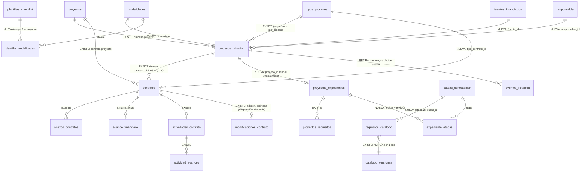
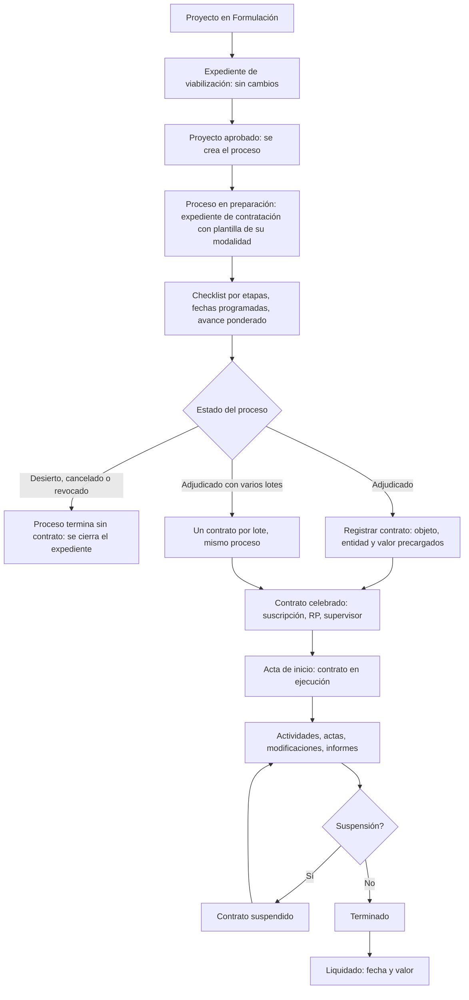

# Procesos contractuales y contratos: propuesta de ajuste

**Fecha:** 2026-11-18
**Rama:** `feature/contratacion`
**Origen:** pedido del usuario del 2026-11-18 ("revisar qué es aplicable en nuestra plataforma y respetar la estructura que ya llevamos").
**Estado:** aprobada por el usuario el 2026-11-18, con las 6 recomendaciones de la sección 12. La fase 2 se divide en las etapas 3A (datos y reglas) y 3B (módulo Contratos, SECOP II, "Registrar contrato" y ficha del proyecto). Además, un contrato puede no tener proyecto. La etapa 3A está validada y aplicada en `gest_pro` (2026-11-18). La etapa 3B (módulo Contratos, sin migraciones) está validada (2026-11-18). La etapa 3C (SECOP II y ficha del proyecto, sin migraciones) está validada (2026-11-18). La fase 3 (expediente de contratación por proceso, migración 20) está validada y aplicada en `gest_pro` (2026-11-18). La etapa 4A (peso por requisito y avance ponderado, migración 21) está validada y aplicada en `gest_pro` (2026-11-19). La etapa 4B (fechas por etapa y avisos, migración 22) está validada y aplicada en `gest_pro` (2026-11-19). La fase 4 queda completa. La fase 5 (revisión por etapa, migración 23) está validada y aplicada en `gest_pro` (2026-11-19). La fase 6 (tablero de Contratación y vista detallada del proceso, sin migraciones) está validada (2026-11-19). La fase 7A (terminación y liquidación del contrato, migración 24) está validada y aplicada en `gest_pro` (2026-11-19). Lo de SECOP II y la ficha del proyecto pasa a la etapa 3C. Este documento no incluye código, migraciones ni cambios en bases de datos.
**Documentos que toca:** `2026-11-17-contratacion-revision-design.md` (sección 10 y etapas 2 a 7) y `2026-11-06-plantillas-checklist-design.md` (solo se consulta; el motor no cambia).

---

## 0. Resumen de decisión

**Recomendación: mantener el proceso y el contrato como dos registros distintos, vinculados, y dejar sin efecto la sección 10 del diseño del 2026-11-17.**

Por qué ahora cambia la respuesta:

1. El pedido nuevo lo exige de forma expresa: los niveles "no se confunden ni se manejan como una misma entidad", un proceso puede terminar sin contrato (desierto, cancelado, revocado) y puede dar varios (lotes, o un acuerdo marco con varias órdenes). Con un solo registro, un proceso desierto es un "contrato desierto", y dos lotes son dos "procesos" con el mismo número. Eso es justo la confusión que el pedido quiere evitar.
2. El esquema real ya está separado: `procesos_licitacion` (ampliada y en uso, etapa 1 aplicada) y `contratos.proceso_licitacion` (FK `nullOnDelete`, ya existe). La sección 10 obligaba a migrar el proceso existente, retirar una pantalla y una API recién entregadas, y reabsorber `ProcesosContratacion` en un servicio de contratos. La separación no retira nada: cumple la restricción "no eliminar funcionalidades".
3. La molestia del usuario era real: objeto, entidad, valor y estado repetidos. Se resuelve sin fusionar tablas (sección 0.1).

### 0.1 Cómo se evita la duplicación manteniéndolos separados

| Dato | Dónde se escribe | Qué ve el usuario en el otro lado |
|---|---|---|
| Modalidad, plataforma, número y enlace del proceso | Solo en el proceso | El contrato los **lee** del proceso (relación). No se copian. |
| Objeto | Proceso | Al "Registrar contrato" el objeto llega **precargado**; el usuario lo ajusta si el lote o la adjudicación lo acota. Se escribe una vez. |
| Entidad contratante | Proceso (catálogo) | Se precarga en `contratos.contratante` (texto). Si el contrato tiene proceso, la pantalla muestra la del proceso y no pide digitarla. |
| Valor | Proceso: **presupuesto oficial** (`monto`). Contrato: **valor adjudicado** (`valor`/`valor_inicial`). | Son cifras distintas (lo estimado frente a lo pactado), no una repetida. Se precarga como sugerencia y se avisa si la suma de contratos supera el presupuesto oficial. |
| Estado | Cada uno con su propio ciclo | Proceso: selección. Contrato: ejecución. No comparten valores (sección 8). |
| Flujo en pantalla | Una sola "línea" Proceso → Contrato | La ficha del proceso lista sus contratos; el contrato muestra "Proceso: LP-001-2026" con enlace. Un botón "Registrar contrato" en el proceso adjudicado. |

Regla de oro: **lo que ya está en el proceso se lee, no se vuelve a escribir; lo que cambia de naturaleza (valor, objeto del lote) se precarga una vez y de ahí en adelante es del contrato.**

### 0.2 Qué pasa con la sección 10

Queda **sustituida por esta propuesta** (se deja una nota de reemplazo al inicio del diseño, no se borra el texto, para conservar la trazabilidad de la decisión):

| Elemento de la sección 10 | Destino |
|---|---|
| Un solo registro con dos fases | **Cancelado.** Dos registros vinculados. |
| Migración 18 `unifica_proceso_en_contrato` (columnas de proceso en `contratos`, copia del proceso existente como contrato) | **Cancelada.** No se agregan `modalidad_id`, `plataforma`, `codigo_proceso`, `url_proceso`, `entidad_contratante_id` a `contratos`. |
| Retirar pantalla, API y servicio de procesos | **Cancelado.** Se conservan y crecen. |
| Estados unificados en un flujo | **Se separan** (sección 8). Del texto libre a valores controlados sí se conserva, solo para los contratos. |
| `estado_original` y conversión de los 7 contratos | **Se conserva**, sin las columnas de proceso. |
| Expediente colgado de `contrato_id` | **Cambia a `proceso_id`.** |
| Los indicadores de contratos solo cuentan contratos en ejecución | **Se conserva** como regla, pero ya no hace falta: un contrato siempre es de ejecución. |
| Lotes y proceso desierto | Se resuelven de forma natural: 1 proceso → N contratos; el desierto es un proceso. |

Lo que no se pierde del trabajo hecho: el commit `1c14941` solo documentó la sección 10; no hay código que revertir. La etapa 1 (código) queda intacta.

---

## 1. Diagnóstico de la arquitectura actual

| Pieza | Estado real |
|---|---|
| `proyectos` | Sin timestamps. Fuente vía `proyecto_fuentes`, sector, fase (`fases`; "Licitación" es solo etiqueta), `presupuesto` y `presupuesto_proyecto`. |
| `procesos_licitacion` | Ampliada y aplicada en la base real: objeto, plataforma, `url_proceso`, estado (7 valores), `usuario_creo_id`, timestamps, `codigo_proceso`, `modalidad`, `entidad_contratante`, `monto`, `tipo_proceso`, `tipo_proponente`, `entidad_proponente`. En la base real hay 1 proceso. |
| Catálogos | `modalidades` (6 con `clave`), `etapas_contratacion` (11). `tipos_procesos` vacío y sin métodos. |
| API de procesos | `routes/contratacion.php` + `App\Services\Contratacion\ProcesosContratacion`: validación, historial en `checklist_historial` (entidad `proceso`), control de edición concurrente. Diálogo `ProcesosProyecto.jsx` desde Parámetros → Proyectos. |
| `contratos` | Sin timestamps. `proceso_licitacion` existe y nadie lo usa (7 contratos, ninguno vinculado). `estado` es texto libre ("En ejecución", "vigente", "liquidado"; el formulario ofrece vigente, ejecutado, liquidado, suspendido, anulado). Solo se muestra como etiqueta: `kpisDashboard.js` deliberadamente no lo usa, así que normalizarlo es de bajo riesgo. |
| Ejecución | `anexos_contratos`, `avance_financiero` (actas con `valor_facturado`), `actividades_contrato` (con `peso`) + `actividad_avances`, `modificaciones_contrato` (adición y prórroga, recalculan valor y fecha fin). `avance_fisico` sin uso. |
| Deuda en contratos | CRUD completo en `ProyectoController`; `guardarContrato` sin validación y sobrescribe `valor` y `fecha_fin`. Pantalla dentro de `Parametros.jsx` (3300 líneas). `cadenaPresupuestal.js` suma `contratos.valor` sin filtrar por estado. |
| Motor de checklists | Plantillas versionadas, expedientes (`proyectos_expedientes`) con filas (`proyectos_requisitos`), estados, responsable, soportes, "no aplica" con aprobación, historial, versiones nuevas con vista previa, requisitos propios. **Sin ponderaciones ni fechas límite**: el avance es cumplidos / los que cuentan; los opcionales no cuentan. |
| Etapa 2 de contratación | Ensayada, sin aplicar: `plantillas_checklist.uso`, asociación a modalidades, `requisitos_catalogo.etapa_id`, comando que siembra el borrador "Licitación pública – SECOP II" (25 ítems, 11 etapas). |

**Conclusión del diagnóstico:** el modelo base del pedido (Proyecto → Procesos → Contratos → Ejecución) ya está medio construido. Falta: el vínculo operativo proceso → contrato, el checklist del proceso, y datos propios del contrato que hoy no existen.

---

## 2. Qué del pedido aplica

Leyenda: **Aplica** (tal cual), **Aplica con ajuste**, **Después** (válido pero fuera de las primeras fases), **No** (no se hace o ya está).

### Sección 1: Objetivo

| Punto | Veredicto | Comentario |
|---|---|---|
| Un proyecto, varios procesos, cada uno con su seguimiento | **Aplica** | Ya es así en datos; falta el seguimiento (expediente por proceso). |
| Cadena Proyecto → Procesos → Contratos → Ejecución → Cierre y liquidación | **Aplica con ajuste** | Cierre y liquidación hoy son solo un estado de texto. Se agregan fechas y valor de liquidación en una fase posterior. |
| No se confunden ni son la misma entidad | **Aplica** | Es el fundamento de la recomendación. |

### Sección 2: Conceptos

| Punto | Veredicto | Comentario |
|---|---|---|
| Proyecto conserva su información | **Aplica** | Sin cambios. |
| Proceso: número SECOP, modalidad, objeto, presupuesto oficial, estado, enlace | **Aplica** | Ya existen (`codigo_proceso`, `modalidad`, `objeto`, `monto`, `estado`, `url_proceso`). |
| Proceso: fuente, fechas de apertura y cierre, responsable, observaciones | **Aplica con ajuste** | Columnas nuevas (sección 6). Las fechas de apertura y cierre son las **legales** de SECOP; no se confunden con las fechas programadas por etapa, que son plazos internos de control. |
| Proceso: nombre | **No** | `codigo_proceso` + `objeto` identifican al proceso. Un "nombre" más sería otra repetición. |
| Proceso: evidencias | **Aplica (ya está)** | Son los soportes de cada ítem del checklist. No se crea un repositorio paralelo. |
| Estados sugeridos (10) | **Aplica con ajuste** | Se agrega solo `revocado`. "En recepción de ofertas", "en observaciones" y "en evaluación" duplican etapas del checklist; la etapa actual ya lo dice. "Terminado sin adjudicación" es el género de desierto, cancelado y revocado. Decisión abierta 2. |
| Contrato: número, objeto, contratista, valores, fechas inicio y fin, interventor, estado | **Aplica (ya está)** | Existen. |
| Contrato: tipo, identificación del contratista, fecha de suscripción, supervisor, registro presupuestal, acta de inicio | **Aplica con ajuste** | Columnas nuevas. `tipo` reutiliza `tipos_procesos`, hoy vacío. |
| Contrato: plazo | **No se almacena** | Se calcula de fecha de inicio y fin (que ya se recalcula con prórrogas). Guardarlo crearía una tercera cifra que se desincroniza. |
| Contrato: garantías y documentación | **Después / con ajuste** | La documentación ya es `anexos_contratos`. Las garantías se manejan primero como anexos con un tipo; una tabla con vigencias y alertas de vencimiento solo si se pide. |
| Un proceso puede terminar sin contrato; un proyecto puede tener varios procesos y contratos | **Aplica** | La FK nullable ya lo permite. |

### Sección 3: Checklist por proceso

| Punto | Veredicto | Comentario |
|---|---|---|
| Reutilizar el motor, plantilla por modalidad | **Aplica** | Es la etapa 2 ya ensayada más el expediente de contratación. |
| Lista de ejemplo de 18 pasos de licitación pública | **Aplica con ajuste** | No se siembra una segunda plantilla. Se contrasta con el borrador de 25 ítems en 11 etapas y se ajusta el borrador. Cualquier cambio lo valida la entidad antes de publicar. |

### Sección 4: Configuración del checklist

| Punto | Veredicto | Comentario |
|---|---|---|
| Plantillas por modalidad, etapas, actividades, obligatoriedad, responsables, evidencias, observaciones | **Aplica (ya está)** | Es el motor actual (`caracter`, responsable, soportes, observación). |
| "No aplica" con justificación; quién verificó y cuándo | **Aplica (ya está)** | Incluye aprobación y historial. |
| Cada proceso su propia instancia | **Aplica** | Expediente con `proceso_id`. |
| **Ponderaciones** | **Aplica con ajuste (cuidado)** | El motor cuenta casillas. Se agrega `peso` por requisito **solo para plantillas de contratación**; la viabilización sigue contando casillas y no cambia ni una cifra. Peso por defecto 1 (con todos en 1 el resultado es idéntico al conteo). Sección 3 y regla R10. |
| **Fechas límite** | **Aplica con ajuste** | Por **etapa**, no por actividad: son las `fecha_programada` ya diseñadas en `expediente_etapas`. Por ítem multiplica el mantenimiento (25 fechas por proceso) y no aporta avisos mejores. Fecha por ítem: después, si se pide. |

### Sección 5: Avance

| Punto | Veredicto | Comentario |
|---|---|---|
| Avances independientes: proyecto, proceso, contrato (físico y financiero) | **Aplica** | Ya son tres medidas distintas en tres lugares; se prohíbe sumarlas o promediarlas entre sí. |
| Avance del proceso ponderado | **Aplica con ajuste** | Ver ponderaciones. |
| Pendientes, vencidas, próximas a vencer | **Aplica** | Sobre `expediente_etapas` y `fecha_cierre` del proceso. |
| Procesos sin actualización | **Aplica con ajuste** | Se calcula con el último evento de `checklist_historial` del proceso o su `updated_at`. Umbral en configuración (por defecto 15 días); no hay tabla nueva. |
| Hitos completados | **Aplica** | Etapas con todo lo que cuenta cumplido (o aprobadas, cuando exista la revisión). |

### Sección 6: Ejecución

| Punto | Veredicto | Comentario |
|---|---|---|
| Contrato asociado a su proceso al adjudicar | **Aplica** | "Registrar contrato" desde el proceso. |
| Acta de inicio | **Aplica con ajuste** | `fecha_acta_inicio` + el documento como anexo. |
| Cronograma | **Aplica (ya está)** | Fechas del contrato más `actividades_contrato`. No se crea otro cronograma. |
| Actividades, avances físico y financiero | **Aplica (ya está)** | Sin cambios. Se mantiene "avance contractual ≠ avance físico". |
| Modificaciones y prórrogas | **Aplica (ya está)** | Existen y recalculan. |
| Obligaciones | **Después** | No existe. Las obligaciones contractuales son cualitativas; mezclarlas con `actividades_contrato` (que tienen peso y alimentan el avance físico) falsearía el avance. Si se piden, tabla propia sin peso. |
| Pagos | **Después / con ajuste** | Hoy hay **facturado** (actas), no **pagado**. Decisión abierta 5. |
| Informes de supervisión | **Después** | No existe. Registro liviano (periodo, fecha, resumen, anexo). |
| Suspensiones y reinicios | **Después, reutilizando** | Evaluar nuevo tipo en `modificaciones_contrato` antes de crear tabla: una suspensión corre la fecha de fin en los días suspendidos, igual que una prórroga. |
| Terminación y liquidación | **Aplica con ajuste** | Estados `terminado` y `liquidado` + fecha y valor de liquidación. |
| Distinguir hitos de control de registros operativos y financieros | **Aplica** | Hitos = checklist del proceso. Operativo = actividades y avances. Financiero = actas. Tres tablas, tres pantallas. |

### Sección 7: Arquitectura

| Punto | Veredicto | Comentario |
|---|---|---|
| Proyecto 1–N procesos; proceso 1–N contratos; proceso sin contrato | **Aplica** | |
| "Contrato pertenece a su proceso" | **Aplica con ajuste** | Opcional (`proceso_licitacion` nullable). Los 7 contratos actuales, los convenios y las contrataciones fuera de plataforma no tienen proceso. Los contratos nuevos sugieren proceso y avisan si no se elige (decisión abierta 4). |
| Checklist por proceso; seguimiento de ejecución por contrato | **Aplica** | |
| Acuerdos marco e instrumentos de agregación de demanda (Tienda Virtual) | **Aplica con ajuste** | La plataforma `tvec` ya existe. Una compra por acuerdo marco se cierra con una **orden de compra**, no con un contrato firmado tras una adjudicación: se cubre con una modalidad nueva en el catálogo (administrable, sin código), un tipo "orden de compra" y una plantilla propia que valida jurídica. No se siembra contenido legal. Decisión abierta 6. |

### Sección 8: Interfaz

| Punto | Veredicto | Comentario |
|---|---|---|
| Ficha del proyecto con información general, formulación, procesos, contratos, ejecución y cierre | **Aplica con ajuste** | Cuatro bloques visibles: General, Formulación (enlace al expediente que ya existe), Procesos, Contratos. Ejecución y cierre viven **dentro del detalle de cada contrato**, no como pestañas del proyecto (un proyecto con tres contratos no tiene "una" ejecución). |
| Listado de procesos con número, modalidad, objeto, presupuesto, estado, % de avance, fecha de cierre, alertas, acceso al checklist | **Aplica** | |
| Vista detallada del proceso | **Aplica** | Ruta propia `/contratacion/:procesoId` sobre `ExpedienteViabilizacion` en modo contratación (ya previsto). |
| Sin sobrecargar, identidad visual actual | **Aplica** | Armazón y tokens `--gp-*`. |

### Sección 9: Restricciones

| Restricción | Cómo se cumple |
|---|---|
| No eliminar funcionalidades | La separación no retira nada; la sección 10 sí lo hacía. |
| No duplicar el sistema de checklists | Un solo motor; `tipo` en el expediente. |
| No confundir proceso con contrato ni avance contractual con físico | Dos tablas, dos estados, tres avances sin mezcla. |
| No asumir que todo proceso se adjudica | Estados de cierre sin contrato (desierto, cancelado, revocado). |
| No exigir contratos al crear el proyecto | Nada lo exige. |
| Trazabilidad y auditoría | `checklist_historial` para proceso, contrato y revisión. |
| Respeto del histórico y compatibilidad | Los 7 contratos se normalizan sin perder el texto original; el proceso existente no se toca. |

---

## 3. Diferencias entre el modelo actual y el propuesto

| Tema | Hoy | Propuesto |
|---|---|---|
| Proceso | Tabla ampliada con pantalla propia; sin checklist; sin fechas ni responsable. | Más fuente, fechas de apertura y cierre, responsable y observaciones; su propio expediente. |
| Contrato | Sin vínculo en uso con el proceso; datos de la contratación y de la ejecución mezclados; estado libre. | Vinculado al proceso (opcional); campos de ejecución propios; estado controlado. |
| Relación | `contratos.proceso_licitacion` sin uso. | 1 proceso → N contratos, con precarga y lectura del proceso. |
| Diseño vigente | Sección 10: un solo registro; retirar la pantalla y la API de procesos. | Dos registros; todo lo de la etapa 1 se conserva. |
| Checklist | Solo viabilización; avance por conteo. | Viabilización igual; contratación con avance ponderado (peso por requisito, 1 por defecto). |
| Expediente | `tipo` implícito (viabilización). | `tipo` explícito y `proceso_id` para contratación. |
| Etapas | Catálogo `etapas_contratacion` sin uso. | Etapas del expediente con fecha programada y real (`expediente_etapas`), luego revisión. |
| Alertas | Dashboard con eventos de proyecto. | Vencidas, próximas, sin actualización e hitos de procesos. |
| Estados de contrato | Texto libre. | Valores controlados: celebrado, en_ejecucion, suspendido, terminado, liquidado, anulado. |
| Avance | Proyecto, físico y financiero del contrato. | Igual, más el avance del proceso; no se mezclan. |
| Cierre | Estado de texto. | Estado + fecha y valor de liquidación (fase posterior). |

---

## 4. Diagrama entidad-relación propuesto

Convención de etiquetas: **EXISTE** (se reutiliza sin cambio de estructura), **AMPLÍA** (tabla existente con columnas nuevas), **NUEVA** (tabla o relación que no existe), **RETIRA** (queda sin uso o se aparta del plan).

| Estado | Elementos |
|---|---|
| Se reutiliza | `proyectos`, `procesos_licitacion`, `contratos`, `modalidades`, `etapas_contratacion`, `proyectos_expedientes`, `proyectos_requisitos`, `checklist_historial`, `anexos_contratos`, `avance_financiero`, `actividades_contrato`, `actividad_avances`, `modificaciones_contrato`, catálogo `responsable`, `fuentes_financiacion`, `tipos_procesos` |
| Se amplía | `procesos_licitacion`, `contratos`, `proyectos_expedientes` (`tipo`, `proceso_id`), `requisitos_catalogo` (`etapa_id`, `peso`), `plantillas_checklist` (`uso`) |
| Nuevo | `expediente_etapas`, `plantilla_modalidades` |
| Se retira del plan | Migración 18 de la sección 10; columnas de proceso en `contratos`; `proyectos_expedientes.contrato_id`. `eventos_licitacion` y `avance_fisico` quedan sin uso (se deciden aparte). |

---

## 5. Flujo funcional (de la formulación a la liquidación)

Puntos de control:
- El proceso termina cuando cierra su expediente y llega a un estado final (celebrado o sin adjudicación).
- Registrar contrato **no cambia solo** el estado del proceso: al guardar el primer contrato, la pantalla propone pasar el proceso a "celebrado" y pide confirmación (coherente con "los estados los cambia una persona").
- Un proceso puede tener varios contratos antes o después de cerrar su expediente.
- Contratos sin proceso (antiguos, convenios) entran directo a la rama de ejecución.

---

## 6. Tablas y relaciones

Nombres en español sin tildes, siguiendo la nomenclatura existente (`usuario_creo_id`, `url_proceso`, `fecha_inicio`). La serie de migraciones sigue el sufijo de los archivos (`..._100015` en adelante); el diseño del 2026-11-17 numeraba 13 a 15 para lo que en archivos es 12 a 14.

### 6.1 `procesos_licitacion` (amplía)

| Columna | Tipo | Notas |
|---|---|---|
| `fuente_id` | FK `fuentes_financiacion`, restrict, nullable | La fuente que financia este proceso; el proyecto puede tener varias. |
| `fecha_apertura` | date, nullable | Fecha publicada en SECOP. |
| `fecha_cierre` | date, nullable | Cierre de ofertas. Alimenta alertas de la lista. |
| `responsable_id` | FK catálogo `responsable`, nullOnDelete, nullable | Quien lleva el proceso. |
| `observaciones` | text, nullable | |
| `estado` | sin cambio de tipo | Se agrega el valor `revocado` en la validación (la columna es `string(20)`; no hay DDL). |

### 6.2 `contratos` (amplía)

| Columna | Tipo | Notas |
|---|---|---|
| `tipo_contrato_id` | FK `tipos_procesos`, restrict, nullable | Reutiliza el catálogo vacío (obra, interventoría, consultoría, suministro, orden de compra…). Verificar el tipo actual de `procesos_licitacion.tipo_proceso`: si ya apunta a este catálogo, el contrato usa el mismo. |
| `contratista_identificacion` | string(30), nullable | NIT o cédula. |
| `fecha_suscripcion` | date, nullable | |
| `supervisor` | string, nullable | `interventoria` se conserva y es otro rol. |
| `numero_rp`, `fecha_rp` | string(40), date, nullable | Registro presupuestal. El CDP vive en el checklist del proceso. |
| `fecha_acta_inicio` | date, nullable | El documento va como anexo. |
| `estado_original` | text, nullable | Texto antes de normalizar. |
| `usuario_creo_id`, `created_at`, `updated_at` | nullable | Hoy la tabla no tiene timestamps; quedan nulos en los contratos antiguos. |
| `estado` | sin cambio de tipo | Valores controlados (sección 8). |
| Fase posterior | `fecha_terminacion_real`, `fecha_liquidacion`, `valor_liquidado` | Solo cuando se haga cierre y liquidación. |

No se agregan a `contratos`: modalidad, plataforma, código ni enlace del proceso (se leen vía `proceso_licitacion`), ni `plazo`.

### 6.3 Motor de checklists

| Tabla | Cambio |
|---|---|
| `plantillas_checklist` | `uso` (viabilizacion por defecto) y asociación a modalidades (`plantilla_modalidades`, `todas_modalidades`): etapa 2 ensayada, sin cambios. |
| `requisitos_catalogo` | `etapa_id` (etapa 2 ensayada) y **`peso`** (smallint sin signo, por defecto 1; se ignora en viabilización). |
| `proyectos_requisitos` | `etapa_propia_id` (etapa 2 ensayada). Ya no se planea una fecha por ítem. |
| `proyectos_expedientes` | `tipo` (`viabilizacion` por defecto) y `proceso_id` (FK `procesos_licitacion`, restrict, único, nullable). Verificar si existe un índice único por proyecto que impida más de un expediente (la contratación tendrá varios por proyecto). |
| `expediente_etapas` (nueva) | Como en el diseño: `expediente_id`, `etapa_id`, `fecha_programada`, `fecha_real`, `estado_revision`, `usuario_reviso_id`, `fecha_revision`, `observacion_revision`, `pendientes_al_aprobar`; único (expediente, etapa). Se crea por fases: primero fechas, luego revisión. |
| `checklist_historial` | Sin cambios de estructura. Nuevas entidades: `contrato` y `etapa`. |

### 6.4 Relaciones y borrado

- `contratos.proceso_licitacion`: `nullOnDelete` se mantiene, pero **un proceso con contratos o con expediente no se elimina** (validación en servicio y `restrict` en `proceso_id` del expediente). Se desactiva o se cancela.
- Un contrato debe tener el mismo `proyecto` que su proceso (validación, R3).

---

## 7. Cambios en backend y frontend

### 7.1 Backend

| Pieza | Cambio | Reutiliza |
|---|---|---|
| `ProcesosContratacion` | Nuevos campos (fuente, fechas, responsable, observaciones); estado `revocado`; acción "registrar contrato" que devuelve la precarga; crea el expediente al crear el proceso si hay plantilla compatible | Servicio, validación e historial actuales |
| `ContratosService` (nuevo, en `App\Services\Contratacion`) | Extrae de `ProyectoController` crear/editar contrato con **validación** (hoy no hay) y deja de sobrescribir `valor`/`fecha_fin` salvo por las modificaciones; precarga desde proceso; estados controlados; historial | Patrón de `ProcesosContratacion`: validación, historial, control de edición concurrente |
| `ProyectoController` | Delega en el servicio; se implementa `eliminarContrato` (con restricción: solo si no tiene actas, avances ni modificaciones, o se anula) | Rutas existentes |
| Expedientes | `tipo` y `proceso_id`; `Proyecto::expedientes()` filtra viabilización; el resumen, la creación automática y `expedientes:crear-faltantes` se limitan a ella | Todo el servicio de expedientes |
| Avance | `Progreso` calcula ponderado **solo si** `tipo = contratacion`; en viabilización se ignora `peso` | `progresoDe` actual |
| Alertas | Servicio de lectura: etapas vencidas y próximas, `fecha_cierre` próxima, procesos sin actualización, hitos | `expediente_etapas`, `checklist_historial` |
| Plantillas | Etapa 2 ensayada tal cual; `peso` en el constructor de requisitos | `CatalogoService`, versiones |
| Catálogos | Administración de `tipos_procesos` (hoy sin métodos), en el patrón de `CatalogoModalidades` | `CatalogoModalidades.jsx` y su API |
| Regla de `cadenaPresupuestal.js` | Pendiente conocido: suma contratos sin filtrar por estado; se corrige excluyendo `anulado` al normalizar estados | |

### 7.2 Frontend

| Pantalla | Cambio |
|---|---|
| Ficha del proyecto | Bloques General, Formulación, Procesos, Contratos (sección 2, punto 8). Procesos reutiliza `ProcesosProyecto.jsx`. |
| Proceso (lista) | Columnas: número, modalidad, objeto, presupuesto, estado, % avance, fecha de cierre, alertas, botón al checklist. |
| Proceso (detalle) | `ExpedienteViabilizacion` en modo contratación, ruta `/contratacion/:procesoId` (verificar con `php artisan route:list` que no choque con la API). Cabecera con los datos del proceso y sus contratos. |
| Contratos | Se extrae de `Parametros.jsx` un componente `ContratosProyecto.jsx` por pasos, empezando por crear/editar. Cada contrato muestra su proceso, y su detalle agrupa ejecución (actividades, actas, modificaciones, anexos). |
| "Registrar contrato" | Botón en el proceso adjudicado: abre el formulario de contrato con precarga. |
| Plantillas de checklist | Campo `peso` visible solo en uso contratación. |
| Parámetros | Pantalla de tipos (reutilizado `tipos_procesos`). |
| Tablero | Vista "Contratación" y alertas (fase final). |

No se crea un segundo motor: el checklist del proceso es el expediente existente.

---

## 8. Reglas de negocio

| # | Regla |
|---|---|
| R1 | Un proceso pertenece a un proyecto. Un proyecto puede tener 0..N procesos. |
| R2 | Un proceso puede terminar sin contrato. Un proceso puede tener 0..N contratos. |
| R3 | El proyecto del contrato debe ser el del proceso al que se vincula. |
| R4 | Un contrato puede existir sin proceso (antiguos, directos, convenios). Para los nuevos, la pantalla sugiere proceso y avisa si no se elige. |
| R5 | Estados del proceso: preparación, publicado, evaluación, adjudicado, celebrado, desierto, cancelado, **revocado**. Los cambia una persona, nunca se bloquean, y piden confirmación si retroceden o salen de un estado final. |
| R6 | Estados del contrato: celebrado, en_ejecucion, suspendido, terminado, liquidado, anulado. No comparten valores con los del proceso. |
| R7 | Solo se ofrece "Registrar contrato" con el proceso en adjudicado o celebrado. Al guardar el primer contrato se propone pasar el proceso a celebrado, con confirmación. |
| R8 | Lo precargado desde el proceso (objeto, entidad, valor) es editable y no se resincroniza después. |
| R9 | La suma de `valor_inicial` de los contratos de un proceso mayor al `monto` genera aviso, no bloqueo. |
| R10 | El avance de viabilización es cumplidos / los que cuentan, sin pesos. El de contratación es la suma de pesos cumplidos / la suma de pesos de los que cuentan; opcionales y "no aplica" aprobado no cuentan. Con todos los pesos en 1 es igual al conteo. |
| R11 | Un proceso no se elimina si tiene contratos o expediente; se cancela. Un contrato no se elimina si tiene actas, avances o modificaciones; se anula. |
| R12 | Un expediente cerrado queda congelado (regla del diseño de la etapa 4). |
| R13 | El avance del proyecto, el del proceso, el físico y el financiero del contrato son medidas distintas: ninguna pantalla las suma ni promedia. |
| R14 | Etapa vencida: `fecha_programada` pasada y etapa sin completar. Próxima: faltan 3 días o menos (días calendario). Sin actualización: sin eventos en el historial del proceso ni cambios en N días (15 por defecto). |
| R15 | Los cambios de estado, fechas y revisión de proceso y contrato dejan registro en `checklist_historial`. |
| R16 | Los indicadores de ejecución (`avance_fisico`, `avance_financiero`, anticipo, % contratados) usan solo contratos, nunca procesos; `anulado` queda fuera de la cadena presupuestal. |

---

## 9. Criterios de aceptación verificables

1. **Separación.** Dado un proceso adjudicado con dos lotes, cuando se registran dos contratos, entonces ambos muestran el mismo proceso, la lista del proceso muestra 2 contratos y el proceso sigue siendo uno solo.
2. **Proceso sin contrato.** Dado un proceso en desierto, cuando se cierra su expediente, entonces no existe ningún contrato asociado y ningún indicador de contratos cambia.
3. **Precarga.** Al registrar un contrato desde un proceso, objeto, entidad y valor llegan precargados, y modalidad, plataforma, código y enlace se muestran sin poder digitarse de nuevo.
4. **Coherencia de proyecto.** Vincular un contrato a un proceso de otro proyecto devuelve error de validación.
5. **Contratos antiguos.** Los 7 contratos siguen visibles, con sus avances y modificaciones idénticos antes y después de migrar; su `estado_original` conserva el texto anterior.
6. **Estados.** Un estado de contrato fuera de la lista (por API o por pantalla) es rechazado. Un proceso permite pasar a `revocado`.
7. **Expediente por proceso.** Crear un proceso con una plantilla publicada compatible crea su expediente de contratación; dos procesos del mismo proyecto tienen expedientes independientes.
8. **Viabilización intacta.** La respuesta de la API de los expedientes de viabilización es idéntica antes y después (comparación por expediente: filas, cumplidos, porcentaje, estado), y las pruebas del módulo y la paridad del evaluador pasan.
9. **Avance ponderado.** Con pesos 1 el porcentaje de un expediente de contratación coincide con el conteo; con un requisito de peso 3 de 5 ítems, cumplir solo ese da 3/7 si los otros cuatro pesan 1 (prueba unitaria con valores fijos).
10. **Viabilización ignora el peso.** Un requisito con `peso` distinto de 1 en una plantilla de viabilización no cambia su porcentaje.
11. **Alertas.** Una etapa con fecha programada pasada y sin completar aparece como vencida; con 3 días o menos, como próxima; un proceso sin eventos en 15 días aparece como sin actualización.
12. **Un solo motor.** No se crea ninguna tabla de checklists nueva; el expediente de contratación usa `proyectos_expedientes` y `proyectos_requisitos`.
13. **Borrado protegido.** Eliminar un proceso con contratos o expediente es rechazado; eliminar un contrato con actas es rechazado.
14. **Trazabilidad.** Cambiar el estado de un proceso o contrato y registrar un contrato desde un proceso deja eventos con usuario y fecha en `checklist_historial`.
15. **Compatibilidad de rutas.** Las rutas existentes de contratos y procesos siguen respondiendo igual; la ruta nueva del front no choca con la API.
16. **Reversibilidad.** En una copia de `gest_pro`, cada migración sube, baja y vuelve a subir sin perder datos (sección 10).

---

## 10. Estrategia de migración

**Principio:** nada se mueve ni se borra. Todo cambio es aditivo y cada `down()` conserva lo ingresado o se detiene con un mensaje claro, como en la serie existente (guardas por paso por el DDL no transaccional de MariaDB).

**Procedimiento, igual que en las etapas anteriores:**
1. Respaldo completo de `gest_pro` (volcado SQL) antes de cualquier cambio, con autorización del usuario.
2. Ensayo de subida, bajada y subida en un clon descartable.
3. Comparación antes y después (viabilización, contratos y procesos).
4. Aplicación en `gest_pro` con `migrate` hacia adelante. No se usa `migrate:rollback` en `gest_pro`; si hace falta, se restaura el respaldo.

| Elemento | Qué se hace | Rollback |
|---|---|---|
| **Etapa 1 (ya aplicada)** | No se toca. | n/a |
| **Etapa 2 ensayada** (plantillas de contratación) | Se aplica como está ensayada, repitiendo el ensayo en un clon actual por si la base cambió. El comando que siembra el borrador sigue siendo manual y con autorización; el borrador no se ofrece hasta que la entidad lo publique. | Como lo ensayado: se detiene si hay plantillas de contratación o etapas asignadas. |
| **Contratos: columnas nuevas** | Todas nulas, con timestamps nulos para los antiguos. | `down()` se detiene si alguna columna nueva tiene datos que se perderían. |
| **Contratos: estado** | Se guarda el texto en `estado_original` y se convierte: "En ejecución" y "vigente" a `en_ejecucion`; "liquidado" a `liquidado`; "suspendido" a `suspendido`; "anulado" a `anulado`; "ejecutado" a `terminado`; lo no reconocido queda `en_ejecucion` y se lista en un informe. Los 7 actuales tienen "En ejecución", "vigente" y "liquidado": todos reconocidos. | `down()` restaura `estado_original`; para contratos nuevos (sin original) usa la etiqueta del valor. No se pierde información. |
| **Proceso existente (1)** | Sin conversión. Gana columnas nulas. Su expediente se crea con un comando de "faltantes" de contratación, primero en modo simulación y solo con autorización, después de que haya una plantilla publicada. | Las columnas se quitan solo si están vacías. |
| **`proyectos_expedientes.tipo` y `proceso_id`** | `tipo` con valor por defecto `viabilizacion` (los 10 expedientes quedan como están). | Se detiene si hay expedientes de contratación. |
| **`requisitos_catalogo.peso`** | Por defecto 1 en todas las filas existentes. | Se detiene si algún peso es distinto de 1. |
| **`expediente_etapas`** | Tabla nueva, sin datos de arranque. | Se detiene si tiene registros. |
| **Diseño y planes** | Se agrega al inicio del diseño del 2026-11-17 un aviso: la sección 10 queda sustituida por este documento, y las etapas 3 a 7 se renumeran (sección 11). El plan de la etapa 1 queda como está. No hay planes de etapas 2 a 7 que rehacer. Los commits previos no se reescriben. | n/a |
| **Retiros** | `eventos_licitacion`, `avance_fisico` y `contratos.proceso_licitacion` **no se retiran** (esta última pasa a usarse). Se decide aparte lo que siga sin uso. | n/a |

Verificaciones obligatorias en el clon antes de aplicar:
- Los 7 contratos: mismas cifras de avance físico, financiero, valor vigente y fecha fin.
- Los 10 expedientes de viabilización: mismas filas, cumplidos, porcentaje y estado.
- El proceso: mismos valores en todos sus campos originales.

---

## 11. Plan por fases

Se reordenan las etapas 2 a 7 del diseño. Cada fase tiene su plan, se ensaya en un clon y se valida con el usuario antes de seguir. La etapa 1 ya está hecha.

| Fase | Contenido | Antes era | Lista cuando |
|---|---|---|---|
| 1 | **Plantillas de contratación.** Aplicar la etapa 2 ensayada; `peso` en el constructor (columna incluida aquí si se prefiere una sola entrega) | Etapa 2 | Un administrador crea, asocia a modalidades y publica una plantilla con requisitos por etapa; el comando siembra el borrador. |
| 2 | **Proceso → contrato.** Campos nuevos del proceso y del contrato, estados controlados, `ContratosService` con validación, "Registrar contrato" con precarga, ficha del proyecto con Procesos y Contratos, `tipos_procesos` administrable | Etapa 3 (reemplazada) | Un proceso adjudicado produce uno o varios contratos con datos precargados; los 7 contratos siguen iguales; los criterios 1 a 6, 13 y 15 pasan. |
| 3 | **Expediente de contratación por proceso.** `tipo`, `proceso_id`, creación al registrar el proceso, checklist por etapas, cierre con aviso, avance por conteo | Etapa 4 | Cada proceso tiene su checklist; la viabilización no cambia (criterio 8). |
| 4 | **Ponderación, fechas y alertas.** `peso` activo en el cálculo para contratación, `expediente_etapas` con fechas programada y real, avisos de vencimiento, sin actualización e hitos en la lista de procesos | Parte de la etapa 5 y de la 6 | Criterios 9, 10 y 11. |
| 5 | **Revisión por etapa.** Aprobar y devolver, solo avisa | Etapa 5 | Revisión por etapa registrada en el historial; sin bloqueos. |
| 6 | **Vista detallada y tablero de Contratación.** Vista del proceso, vista "Contratación" del tablero con semáforo y filtros | Etapa 6 | El tablero muestra procesos por estado y etapa, con alertas. |
| 7 | **Ejecución ampliada y cierre.** Por orden y a pedido: terminación y liquidación (fechas y valor), suspensión y reinicio sobre `modificaciones_contrato`, informes de supervisión; luego pagos y obligaciones si se confirman | Nuevo | Cada pieza se entrega por separado y no altera el avance físico ni el financiero. |
| 8 (opcional) | **Días hábiles y SECOP** | Etapa 7 | Como en el diseño vigente. |

Por qué este orden:
- La fase 2 va antes del expediente porque es lo que resuelve la confusión que motivó el pedido (proceso y contrato) y no depende del motor.
- Las ponderaciones y fechas van después de que el expediente funcione con conteo: así se compara primero que el motor generalizado no altere nada, y luego se agrega el cálculo nuevo con una prueba de equivalencia.
- La revisión por etapa sigue al cronograma porque comparte la tabla `expediente_etapas`.

Pendiente de integración: `feature/contratacion` no está en `main`; sigue el mismo criterio de ramas de las etapas anteriores.

---

## 12. Decisiones (aprobadas el 2026-11-18: el usuario aceptó las 6 recomendaciones)

| # | Decisión | Mi recomendación |
|---|---|---|
| 1 | ¿Mantener separados proceso y contrato y dejar sin efecto la sección 10? | **Sí.** El pedido nuevo lo exige, el esquema ya lo soporta y no retira nada hecho. La repetición se resuelve con precarga y lectura del proceso, no con fusión. |
| 2 | ¿Qué estados tiene el proceso? | Los 7 actuales más `revocado`. "Recepción de ofertas", "observaciones" y "evaluación" se leen de la etapa actual del checklist; "terminado sin adjudicación" es desierto, cancelado o revocado. |
| 3 | ¿Dónde van las ponderaciones y las fechas límite? | Peso por **requisito** (1 por defecto, solo contratación) y fecha límite por **etapa**. Fecha por ítem solo si luego se pide. |
| 4 | ¿Se obliga a que un contrato nuevo tenga proceso? | **No.** Se sugiere y se avisa si falta, para no bloquear convenios ni contratos fuera de plataforma. Los 7 existentes quedan sin proceso. |
| 5 | ¿Qué de la ejecución ampliada se hace y en qué orden? | Primero terminación y liquidación, luego suspensión y reinicio (sobre `modificaciones_contrato`), luego informes de supervisión. Pagos reales y obligaciones solo si se confirman: hoy se mide lo **facturado**, no lo **pagado**, y las obligaciones no deben mezclarse con las actividades que dan el avance físico. |
| 6 | ¿Se cubren acuerdos marco y Tienda Virtual? | Sí, como **modalidad nueva en el catálogo** más tipo "orden de compra" y plantilla propia, sin sembrar texto legal. La plantilla la define y valida jurídica antes de publicarla. Se hace cuando haya un caso real. |
